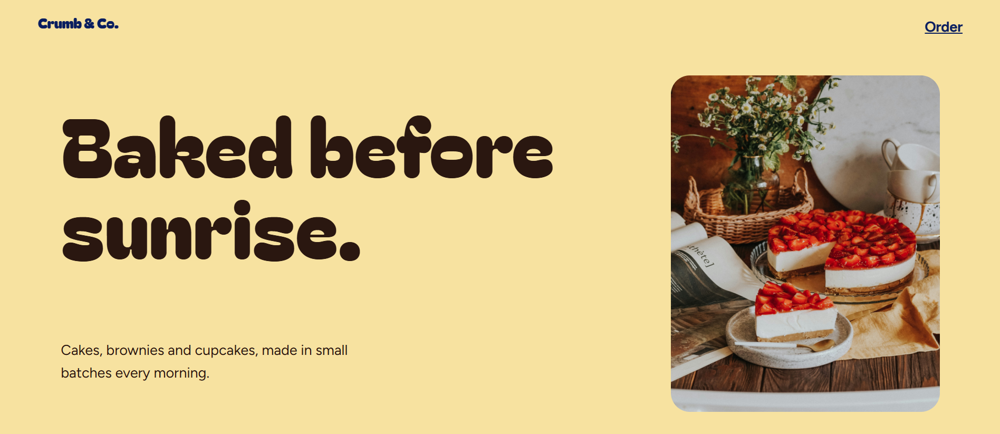

# Crumb & Co. | Scroll-driven bakery story



A scroll-storytelling website for a small-batch bakery (cakes, brownies, cupcakes). The page changes colour, mood and layout as you scroll, like a short interactive film.

**Live demo:** https://fatima-n-khan.github.io/crumb-and-co/

## Features
- Intro preloader with a curtain reveal
- Background colour that transforms chapter by chapter
- Pinned cake animation: layers drop in, a cherry bounces on, sprinkles fall
- Horizontal-scroll menu
- Infinite marquee strip
- 3D tilt on photos and a custom cursor (mouse devices)
- Photo gallery, animated number counters, customer reviews and a footer
- Scroll progress bar
- Smooth scrolling, responsive layout, and reduced-motion support

## Tech stack
HTML, CSS, JavaScript, [GSAP](https://gsap.com) + ScrollTrigger, [Lenis](https://lenis.darkroom.engineering)

## Run locally
1. Download or clone this repository
2. Open the folder in VS Code
3. Start it with the Live Server extension (right-click `index.html` > Open with Live Server)

## Project structure
```
crumb-and-co/
├── index.html    page structure and content
├── style.css     design, colours, layout
├── script.js     all animations (GSAP, ScrollTrigger, Lenis)
└── images/       photos used on the site
```

## Note
The WhatsApp number, Instagram link, address, reviews and numbers on the page are sample content.

## Author
Built by Fatima ([@fatima-n-khan](https://github.com/fatima-n-khan)).

## Credits
Photos from [Unsplash](https://unsplash.com).
